<div align="center">

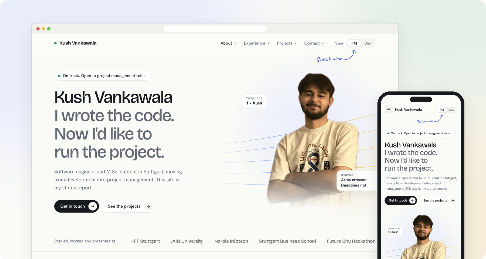

# Kush Vankawala, portfolio

**A software engineer's portfolio, written as a project status report.**

I wrote the code. Now I'd like to run the project.
This site is my status report: what I've delivered, what's in progress, and what's next.

<br>

[](https://kushrvankawala.github.io/)
&nbsp;
[](docs/media/site-tour.mp4)


</div>

<br>

## Contents

- [The idea](#the-idea)
- [See it move](#see-it-move)
- [A walk through the page](#a-walk-through-the-page)
- [Two views: PM and Dev](#two-views-pm-and-dev)
- [On a phone](#on-a-phone)
- [Animations and interactions](#animations-and-interactions)
- [How it's built](#how-its-built)
- [Quality checks](#quality-checks)
- [Folder structure](#folder-structure)
- [Run it on your computer](#run-it-on-your-computer)
- [Make changes](#make-changes)
- [Credits](#credits)

<br>

## The idea

I'm moving from software development into project management, so I built my portfolio the way a
project manager reports on a project. It has an executive summary, figures with their sources, a
Gantt chart of my career, a list of deliverables, a resource plan and a risk register.

It's meant to be serious about the content and relaxed about the tone. The risk register, for
example, lists real "risks" of hiring me, like *"Builds a spreadsheet for things that did not need one."*

Two things make it more than a CV on a web page:

- **It works like a report.** Every section answers a question a hiring manager actually has.
  What have you done? With whom? Can you prove it? What's next?
- **It shows both sides of me.** A switch at the top flips the whole site between a calm
  *PM view* and a terminal-green *Dev view*, with section titles rewritten as code.

<br>

## See it move

<div align="center">
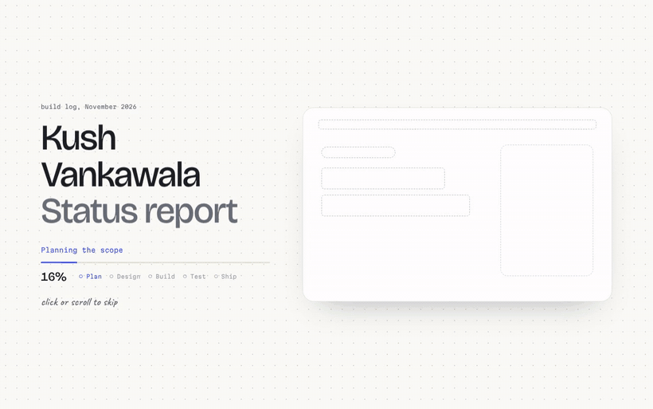
<br>
<sub><b>The intro.</b> The site "builds" itself in five phases (Plan, Design, Build, Test, Ship), gets stamped <i>Delivered</i>, then opens.</sub>
</div>

<br>

> **Full tour:** a 1 minute 38 second recording of the whole page, ending with a switch into the
> Dev view, is in [`docs/media/site-tour.mp4`](docs/media/site-tour.mp4).

<br>

## A walk through the page

The page is a single scroll, numbered like a report. Each section below has a screenshot and a
short note on what it does.

### Top of the page

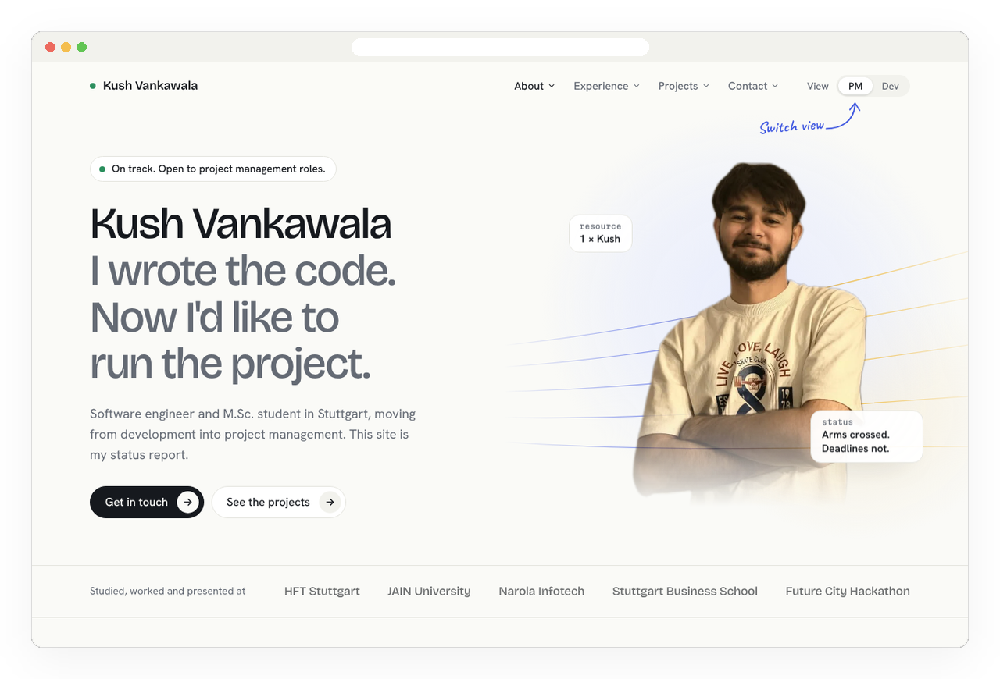

My name and the one-line pitch: *"I wrote the code. Now I'd like to run the project."* The photo
blends into the page with thin lines sweeping behind it. Two small tags float beside it
(*Resource: 1 × Kush* and *Status: Arms crossed. Deadlines not.*). A hand-drawn *Switch view*
arrow points at the PM/Dev switch, and slides across when you flip it.

### The menu

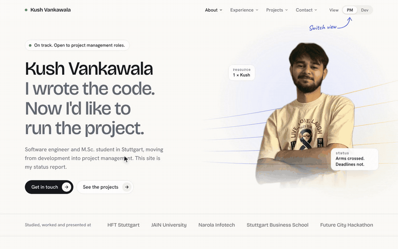

Four menu buttons (About, Experience, Projects, Contact) open frosted-glass panels. Each link is a
small tab with its own icon. A blue highlight glides to whichever tab the cursor is over, the icon
redraws itself, and the section you're reading stays marked with a pulsing dot. On a phone the
same menu becomes a two-column grid of tiles.

### 01 · Executive summary

Who I am in four minutes: from developer to project manager, my roles as class representative and
technical lead during my B.Tech, and three things I bring: *I can read the code*, *I can read the
room*, *I write it down*.

### 02 · How I work

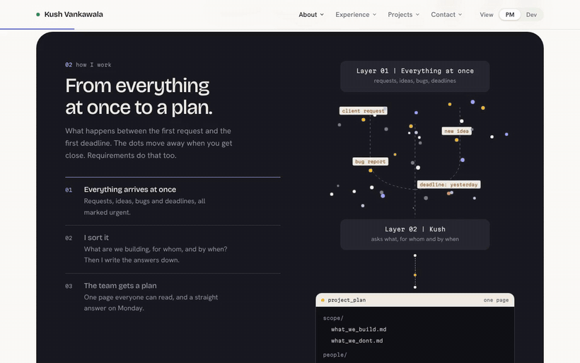

A dark panel that shows my process in three layers: **Everything at once → Kush → The team**.
Dots labelled *client request*, *new idea*, *bug report* and *deadline: yesterday* drift around
and move away from your cursor (requirements do that too). One by one they get pulled into a
one-page project plan, which ends in a Monday stand-up chat.

### 03 · In numbers

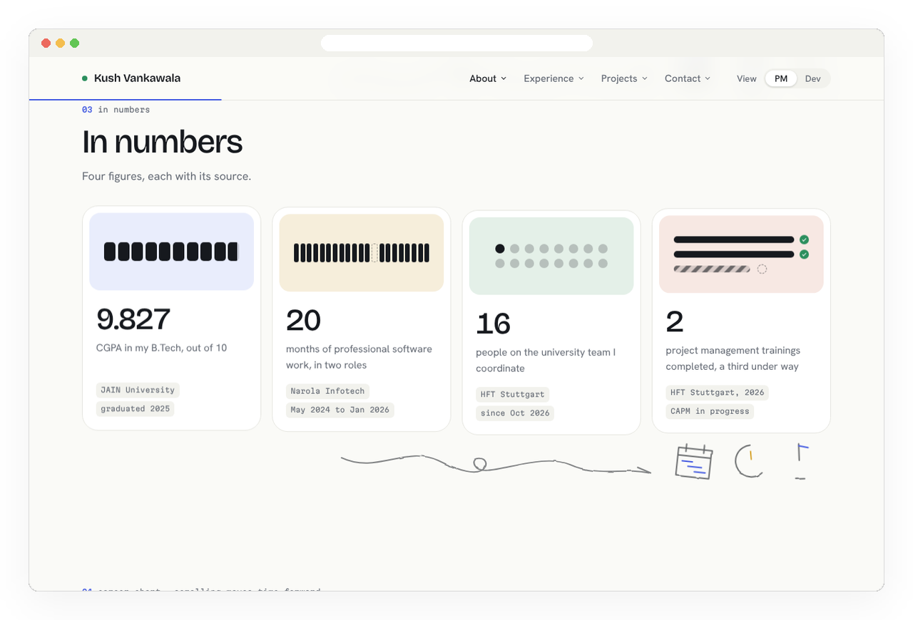

Four figures, each with its source: **9.827** CGPA, **20** months of professional software work,
**16** people on the university team I coordinate, and **2** project management trainings with a
third in progress. The cards float gently, the numbers count up, and each card has its own little
animation: bars filling, a timeline sweeping, a team lighting up in a wave, and ticks for the
completed trainings.

### 04 · Career chart

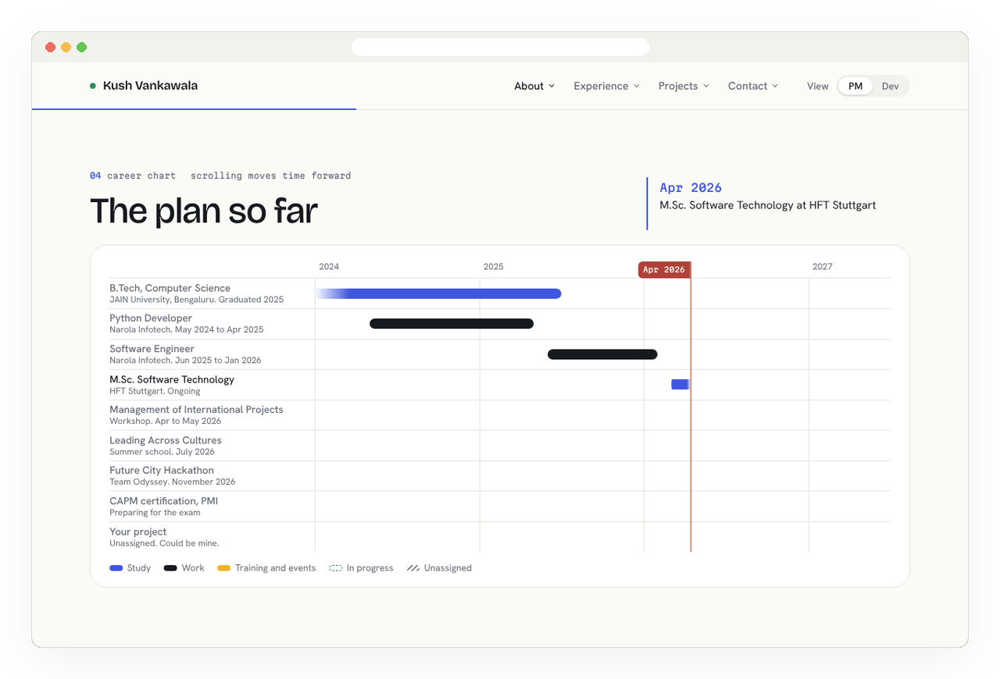

My career as a Gantt chart. **Scrolling moves time forward:** the red *Today* line travels from
January 2024 to now, bars fill in as they happen, and a readout says what I was doing that month.
It ends on the CAPM exam and a row called *Your project. Unassigned. Could be mine.*

### 05 · Work delivered

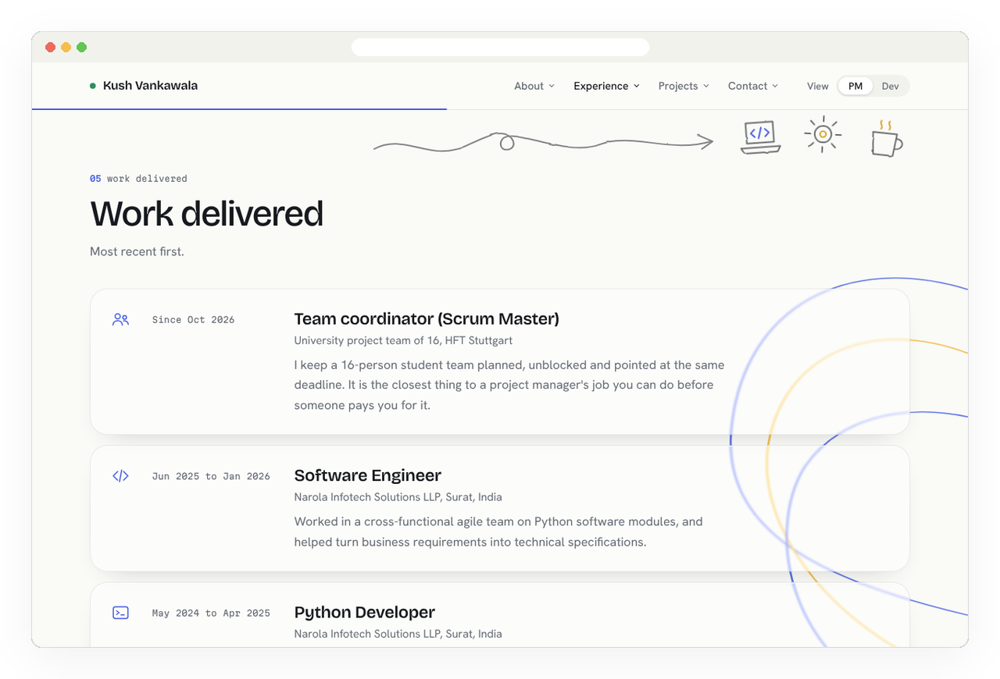

My three roles on translucent glass cards, with thin curved lines drawing themselves behind them:
team coordinator for a 16-person university team, Software Engineer and Python Developer at
Narola Infotech.

### 06 · Deliverables

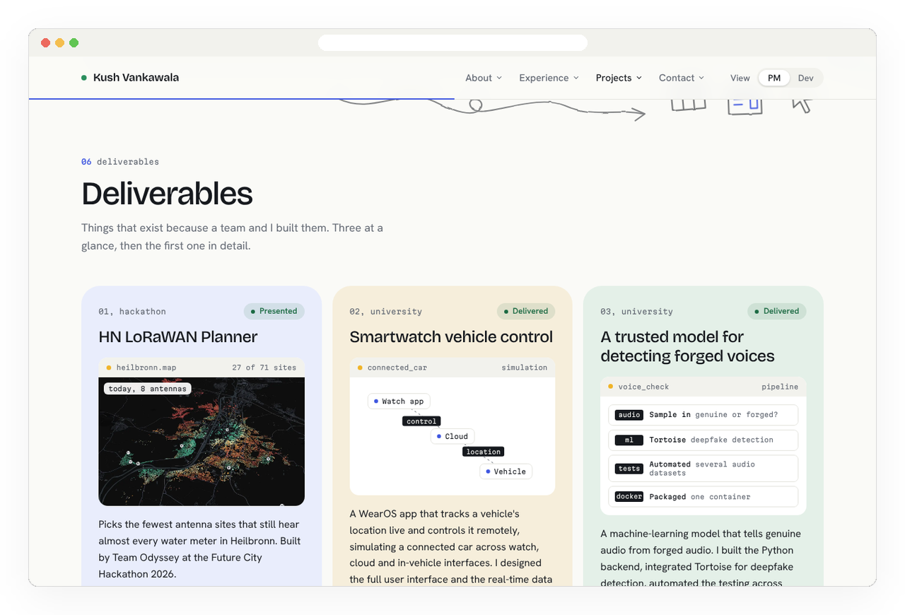

Three projects at a glance, each with a live mini-diagram that plays on hover:

| Project | What the card shows |
|---|---|
| **HN LoRaWAN Planner** (hackathon) | A map of Heilbronn switching from today's coverage to the planned one |
| **Smartwatch vehicle control** (university) | Watch → Cloud → Vehicle, with data moving along the links |
| **Forged voice detection** (university) | The four steps of the detection pipeline lighting up in turn |

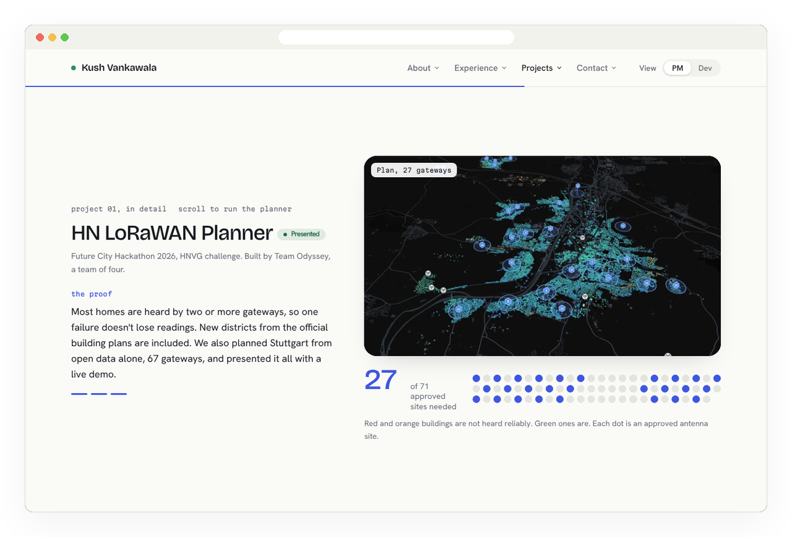

Then the hackathon project in detail. As you scroll, the story moves through *the problem*, *the
plan* and *the proof*. The map of Heilbronn changes from today's patchy coverage to the planned
one, and a counter drops from 71 approved antenna sites to the 27 the planner needs. A screen
recording of the real tool follows.

### 07 · Training and certificates

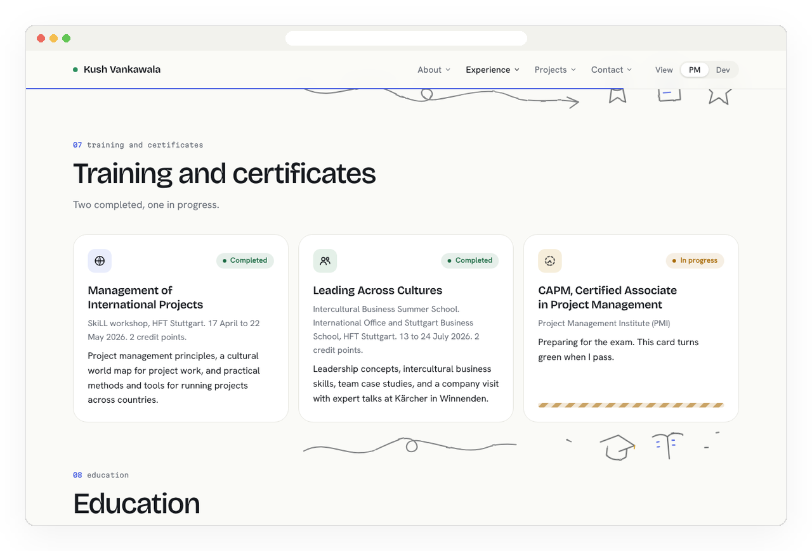

Management of International Projects, Leading Across Cultures (both completed) and CAPM from PMI
(in progress). The icons are animated: the globe turns, the two people bob, the clock ticks. The
CAPM bar has moving stripes until I pass.

### 08 · Education

M.Sc. Software Technology at HFT Stuttgart (current) and B.Tech Computer Science and Engineering
at JAIN University (CGPA 9.827), with my two leadership roles highlighted.

### 09 · Resource plan

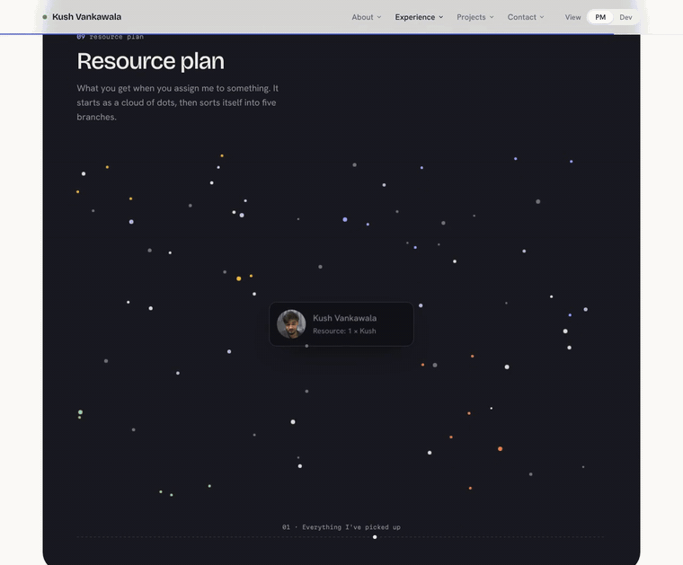

My skills as a graph with me in the middle. It starts as a cloud of dots, the dots fly into place
and become five branches, and the lines draw themselves out from the centre:

| Branch | Skills |
|---|---|
| **Running the project** | Coordination and documentation, requirements analysis, process improvement, agile methods, stakeholder communication |
| **Engineering** | Python (Pandas, NumPy), Java, SQL, Flutter, Docker, AI tools |
| **Data and reporting** | Power BI, Excel, PowerPoint and Word, data analysis and visualisation |
| **Soft skills** | Communication, teamwork, analytical thinking, intercultural collaboration, leadership |
| **Languages** | English (C1), German (B1, certified) |

One branch lights up at a time, and you can hover or tap any branch to pick it.

### 10 · Risk register

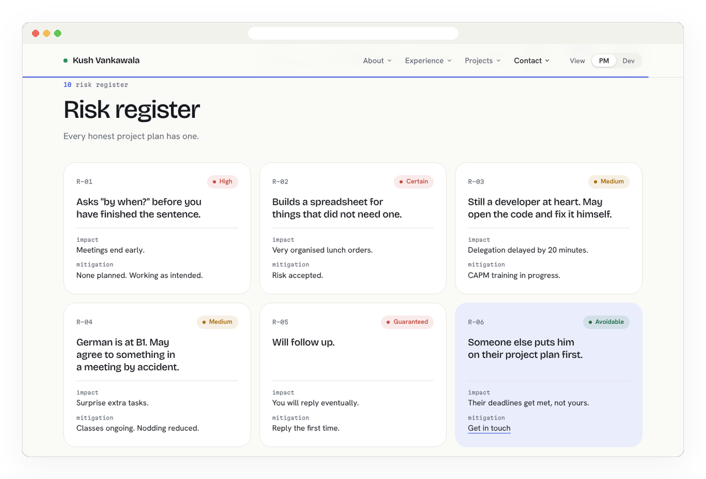

The funny part. Six honest risks with impact and mitigation, such as
*"German is at B1. May agree to something in a meeting by accident."* The last one is
*"Someone else puts him on their project plan first"*, and its mitigation links to the contact
section.

### 11 · Next steps

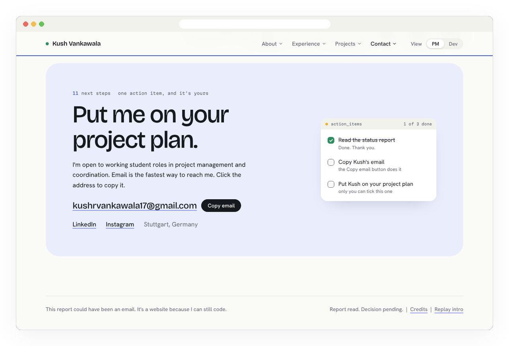

One action item, and it's yours. The email copies itself with one click. A small checklist ticks
itself off: *Read the status report* when you reach the end, *Copy Kush's email* when you copy it,
and *Put Kush on your project plan*, which only the visitor can tick.

### Credits page

A separate page, linked from the footer, saying who built the site and how.

<br>

## Two views: PM and Dev

<div align="center">

<br>
<sub><b>The switch.</b> One click wipes the whole page into the Dev view, starting from the switch itself.</sub>
</div>

<br>

The switch in the top bar flips the whole site. The **PM view** is light and calm, for the people
who read the plan. The **Dev view** is dark and terminal-green, for the people who read the code.
It uses a monospace typeface and a green accent, and every section title is rewritten as code. The site remembers your choice for your next visit.

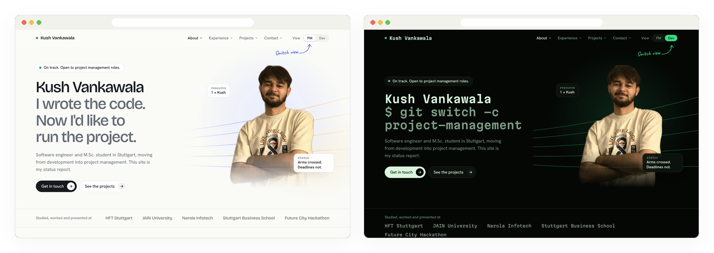

| Section | PM view | Dev view |
|---|---|---|
| Headline | *I wrote the code. Now I'd like to run the project.* | `$ git switch -c project-management` |
| Executive summary | Executive summary | `README.md` |
| How I work | From everything at once to a plan | `pipeline.yml` |
| In numbers | In numbers | `stats.json` |
| Career chart | The plan so far | `career.gantt` |
| Work delivered | Work delivered | `git log --author=kush` |
| Deliverables | Deliverables | `ls projects/` |
| Training and certificates | Training and certificates | `npm test` (*2 passing, 1 pending*) |
| Resource plan | Resource plan | `requirements.txt` |
| Risk register | Risk register | `KNOWN_ISSUES.md` (*Won't fix.*) |

### A look around the Dev view

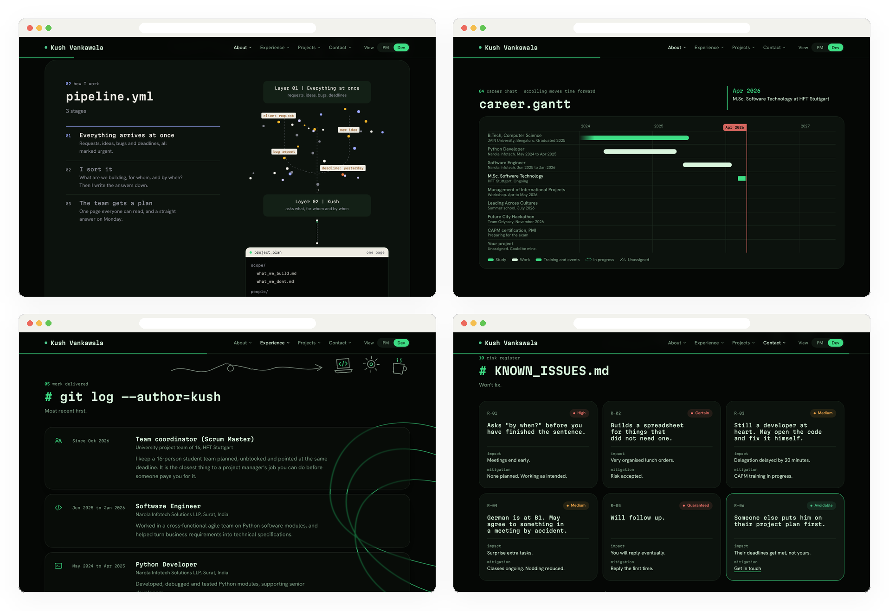

<div align="center">
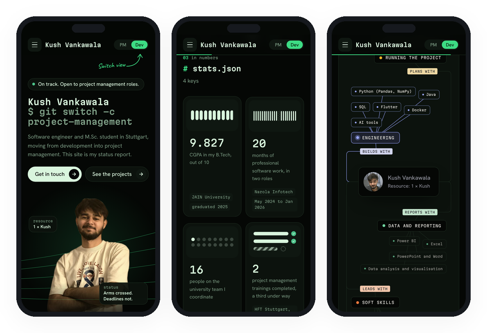
<br>
<sub>The Dev view on a phone: the headline, <code>stats.json</code> and the skills graph.</sub>
</div>

<br>

## On a phone

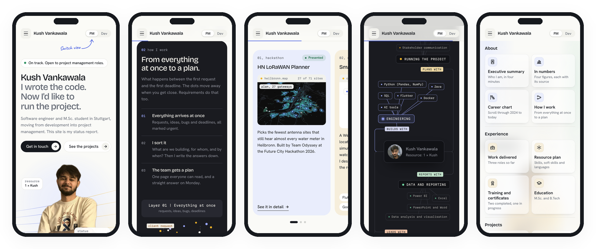

<div align="center">
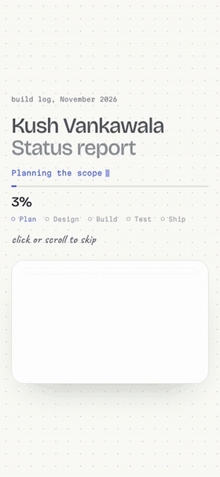
</div>

Everything is designed for phones too. Project and risk cards become swipeable rows with pill
dots, the skills graph stacks with its lines running down the sides, and pinned scroll chapters
turn into normal sections on short screens so nothing is ever cut off.

<br>

## Animations and interactions

| Effect | Where | How it works |
|---|---|---|
| Build-log intro | First load | A wireframe fills in over five phases, then the page slides open. Click, scroll or press a key to skip. *Replay intro* in the footer runs it again. |
| Scroll-driven chapters | Career chart, hackathon | The section stays pinned while scrolling moves a timeline or a story forward. |
| Pencil sketches | Gaps between sections | Hand-drawn icons (a laptop, a gear, a rocket and others) draw themselves stroke by stroke as they scroll into view, with a wobbly pencil line leading in. |
| Dots that dodge you | How I work | The dots move away from the cursor or your finger, then get sorted into the plan. |
| Gliding highlight | Menu | A highlight slides between tabs as the cursor moves, and the icons redraw. |
| Count-ups and mini charts | In numbers | Numbers count to their value. Each card has its own looping animation. |
| Skills graph | Resource plan | Dots fly into place and become the graph, the lines draw out, and branches light up in turn. |
| Soft light on hover | Cards | A gentle glow follows the cursor across cards, which lift slightly. |
| Arrow cursor and click ring | Desktop | A custom arrow cursor and a soft ring wherever you click. |
| View switch | Top bar | A circular wipe between the PM and Dev views. |

Animations pause while their section is off screen. If your device is set to reduce motion, the
intro and animations are skipped and everything is shown straight away.

<br>

## How it's built

**Plain HTML, CSS and JavaScript.** No frameworks, no libraries, no build step. One HTML file holds
the layout, the styles and the scripts, and the `assets` folder holds the photos, maps, video and
fonts.

- **Layout and theming:** CSS grid and flexbox. Colours live in CSS variables, so the Dev view is
  just a second set of values.
- **Scroll effects:** `IntersectionObserver` for reveals, and one scroll loop that drives the pinned
  chapters and the pencil sketches.
- **Drawings:** SVG paths drawn with `stroke-dashoffset`, plus an SVG filter that gives the sketches
  their pencil wobble.
- **Motion:** CSS animations, the Web Animations API (the skills dots) and the View Transitions API
  (the PM/Dev wipe, with a fallback for browsers without it).
- **Glass effects:** `backdrop-filter` for the menu and the work cards.
- **Fonts:** Bricolage Grotesque (headings), Hanken Grotesk (text), Martian Mono (labels and Dev
  view) and Caveat (handwriting). All four are open-source and stored in the project, so nothing
  loads from other websites.

<br>

## Quality checks

Before publishing, the site went through an automated test suite in Chrome, repeated until
nothing failed:

| Check | Result |
|---|---|
| Screen sizes from 320 px phones to 2560 px monitors | No sideways scrolling, no cut-off text |
| Accessibility scan (axe) in the light, phone and Dev views | 0 violations |
| Keyboard only | Every link and button reachable, with a *Skip to content* link and a keyboard-friendly menu |
| Reduce-motion setting | All content visible, no intro |
| Layout shift while loading | 0.008 (anything under 0.1 counts as good) |
| Console errors, broken links, missing files | None |

<br>

## Folder structure

```
kush-portfolio/
├── index.html              The whole site: layout, styles and scripts
├── README.md               This file
├── .nojekyll               Tells GitHub to serve the files exactly as they are
├── assets/
│   ├── kush-hero.webp      Hero photo
│   ├── kush-lake.webp      Executive summary photo
│   ├── kush-avatar.webp    Small photo in the skills graph
│   ├── lora-today.webp     Hackathon map: coverage today
│   ├── lora-plan.webp      Hackathon map: planned coverage
│   ├── lora-demo.mp4       Screen recording of the hackathon tool
│   ├── lora-poster.webp    Still frame shown before the video plays
│   ├── og-image.jpg        Preview image when the link is shared
│   └── fonts/              The four fonts and their licences
└── docs/media/             Screenshots, GIFs and the tour video used in this README
```

<br>

## Run it on your computer

Double-click **`index.html`**. It opens in your browser and works offline.

To run it exactly the way it runs online, open a terminal in this folder and start a small local
server, then visit http://localhost:8000:

```bash
python -m http.server 8000
```

<br>

## Make changes

Everything is in `index.html`, so any text editor works (VS Code is a good choice).

- **Text:** search for the sentence you want to change and edit it in place.
- **Photos:** replace the files in `assets/` with new ones of the same name. Keep the hero photo
  as a cut-out with a transparent background.
- **Colours:** at the top of the `<style>` block, `:root` holds the PM view colours and
  `:root[data-mode="dev"]` holds the Dev view colours.
- **Dev view titles:** each heading has a `data-dev="..."` attribute with its code version.

Save, refresh the browser, and the change is there.

<br>

## Credits

Designed and built by **Kush Vankawala**, with help from **Claude** by Anthropic.

Fonts are open-source under the SIL Open Font License; their licences are in `assets/fonts/`.

© 2026 Kush Vankawala. The photos and personal content on this site are mine; please don't reuse
them without asking.

<div align="center">
<br>
<sub>Thanks for reading the status report. Decision pending.</sub>
</div>
